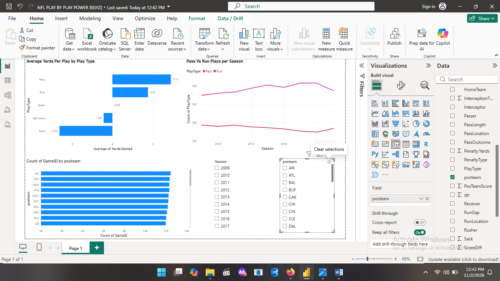
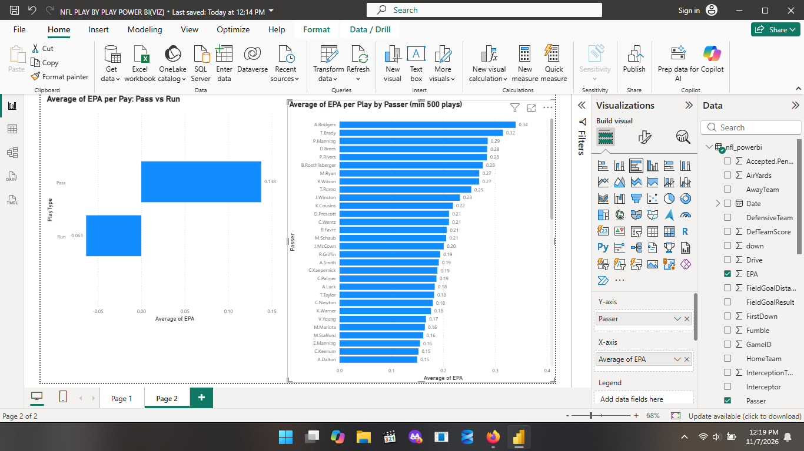
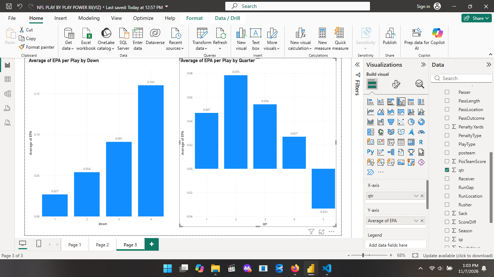

# NFL Play-by-Play: Data Cleaning and Power BI Dashboard

Dataset: NFL Play by Play 2009-2017 (Kaggle, maxhorowitz)

Tools: Python (pandas, numpy) in VS Code with Jupyter, Power BI Desktop, Git and GitHub.

## Cleaning steps
1. Loaded 407,688 rows x 102 columns (27.67% of cells missing)
2. Found most missing values mean "does not apply" (e.g. RunGap on a pass play)
3. Filtered out game events (timeouts, quarter ends): -26,874 rows
4. Filled 5 rare-event text columns with "None"
5. Dropped rows with empty desc or posteam: -54 rows
6. Checked duplicates (0), converted Date to datetime
7. Left EPA, WPA and probability columns as NaN to avoid biasing averages
8. Trimmed to 42 columns for Power BI

## Dashboard

### Page 1: Play types and volume

### Page 2: EPA by play type and passer

### Page 3: EPA by down and quarter

## Key findings
- Passes average about 7.2 yards per play and runs about 4.4. Sacks average about -6.5.
- Passes average about +0.14 EPA per play, runs about -0.06.
- Pass plays outnumber run plays every season, and the gap widens slightly over the period.
- Among passers with at least 500 plays, A.Rodgers (0.34) and T.Brady (0.32) have the highest average EPA.
- Average EPA by quarter peaks in Q2 (about 0.078) and is lowest in regular-time Q4 (about 0.027).

## Limitations
- The passer ranking counts every play with that passer, including sacks, and requires at least 500 plays.
- EPA by down and quarter covers Pass and Run plays only. The higher 4th-down average likely reflects situations where teams chose to go for it.
- Quarter 5 is overtime and has far fewer plays, so its negative average is not reliable.

## How to reproduce
Download the dataset from Kaggle into a Data/ folder, then run practice.ipynb.
